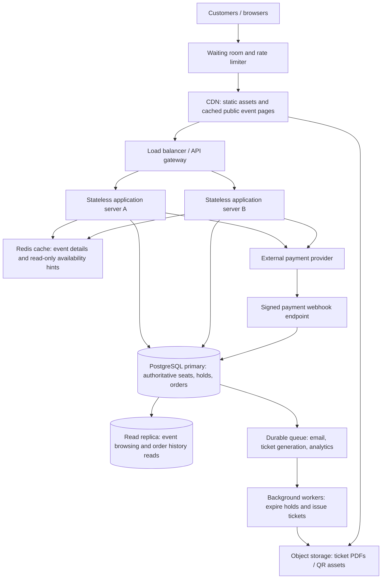

# TicketHub: System Design Document

## 1. Context

TicketHub is a website where people discover concerts and events, view seat availability, reserve seats, pay, and access their tickets. The main design challenge is a popular concert sale: many customers may try to buy the same limited seats at almost the same time. The system must remain responsive and fair while ensuring that a seat is never sold to two customers.

### Goals
- Let users browse events, inspect seat availability, temporarily hold seats, pay, and view confirmed tickets.
- Prevent overselling and double-booking, including when requests arrive concurrently.
- Keep event browsing and seat selection responsive during normal traffic and major sales.
- Provide clear outcomes when a seat is unavailable, a hold expires, or payment fails.

### Non-goals
- Live video streaming of concerts.
- Resale marketplace, dynamic pricing, or ticket transfers in the first version.
- Guaranteeing that every customer gets a ticket when demand exceeds supply. Fairness means applying consistent rules and not selling the same seat twice, not guaranteeing a ticket to everyone.

## 2. Requirements and estimates

### Functional requirements
1. Users can register/sign in and view events and event details.
2. Users can view a seat map and current availability.
3. Users can request a temporary hold on one or more available seats.
4. Users can pay for a valid hold and receive a confirmed order/ticket.
5. Users can view their orders and tickets.
6. The system releases expired holds and releases seats after a failed or cancelled payment.
7. The system provides clear errors for unavailable seats, expired holds, invalid input, and payment failures.

### Non-functional requirements
- **Speed:** event pages should usually load within 2 seconds; seat availability and hold responses should usually complete within 500 ms, excluding external payment-provider time. During a sale, the system should degrade gracefully rather than collapse.
- **Correctness:** a seat can have at most one active hold at a time and at most one confirmed sale. Payment confirmation and order updates must be idempotent so duplicate callbacks do not create duplicate tickets.
- **Fairness:** apply the same queue/hold rules to all customers; rate-limit automated abuse; do not let repeated requests extend a hold indefinitely. If a virtual waiting room is enabled, issue queue tokens and admit users at a controlled rate.
- **Availability:** event browsing should remain available during a sale. If payment or booking dependencies fail, do not claim a ticket is confirmed until payment is verified.
- **Security:** authenticate users, authorise access to their orders, validate input, protect payment callbacks, and avoid storing raw card details.
- **Durability and recovery:** confirmed orders must persist, and backups plus recovery procedures must be tested.

### Traffic and storage estimates
Assumptions are stated so they can be revised with real measurements.

**Normal day**
- 50,000 visitors × 10 page views = **500,000 page views/day**.
- Average page-view rate = 500,000 ÷ 86,400 ≈ **5.8 page views/second**. This is an average; daytime peaks are higher. For initial capacity planning, assume a 10× peak of roughly **58 page views/second**.
- 5,000 tickets sold/day. If each sale creates one order, that is about **0.058 orders/second on average** (5,000 ÷ 86,400). Booking attempts will be higher than completed sales.

**Popular concert sale**
- 200,000 people try to buy within 10 minutes (600 seconds): 200,000 ÷ 600 ≈ **333 purchase attempts/second on average** during the sale window.
- 20,000 seats are available: at most 20,000 successful seat purchases can result, or **about 33.3 sold seats/second** if every seat sells evenly across the ten minutes.
- Requests arrive in bursts and each buyer may browse, refresh a seat map, create a hold, and check out. Therefore, API request rate can be several times the purchase-attempt rate. Plan initially for at least **1,500–2,000 booking attempts/second** in short bursts, load-test the full request mix, and adjust based on measurements.
- Compared with the normal-day average of roughly 0.058 orders/second, 333 purchase attempts/second is over **5,700×** as many attempts per second. This is an intentionally rough comparison between attempts and completed orders; the metrics are not identical. The sale is the capacity-design driver.

## 3. Proposed API

All endpoints use HTTPS and JSON except redirects or downloadable ticket formats. Authenticated endpoints require a valid session/token. Example response bodies are abbreviated.

| Method and path | Purpose | Success response |
|---|---|---|
| `GET /api/events?query=&date=&page=` | Browse/search events with pagination | `200 OK` with event list |
| `GET /api/events/{eventId}` | Get event details and sale rules | `200 OK` with event details |
| `GET /api/events/{eventId}/seats` | Get seat map and availability snapshot | `200 OK` with seats and status |
| `POST /api/holds` | Temporarily hold requested seats | `201 Created` with hold ID and expiry |
| `POST /api/orders` | Create an order from a valid hold and start checkout | `201 Created` with pending order |
| `POST /api/payments/webhook` | Receive signed payment-provider updates | `200 OK` after safely processing event |
| `GET /api/me/tickets` | List current user's confirmed tickets | `200 OK` with tickets |
| `GET /api/orders/{orderId}` | View an order owned by the current user | `200 OK` with order status |

### Example: hold seats
Request:
```http
POST /api/holds
Content-Type: application/json
Authorization: Bearer <token>
```
```json
{
  "eventId": "evt_123",
  "seatIds": ["seat_A10", "seat_A11"]
}
```
Successful response (`201 Created`):
```json
{
  "holdId": "hold_789",
  "status": "active",
  "expiresAt": "2026-11-01T10:05:00Z",
  "seatIds": ["seat_A10", "seat_A11"]
}
```
If any seat is already held or sold, return `409 Conflict` and do not partially hold the requested seats. Other useful codes: `400 Bad Request` for invalid input, `401 Unauthorized` for missing/invalid authentication, `403 Forbidden` for unauthorised access, `404 Not Found` for unknown events/seats/orders, `410 Gone` for an expired hold, `429 Too Many Requests` for rate limits, and `500 Internal Server Error` for unexpected failures. Never include sensitive payment information in errors or logs.

### Example: browse events
`GET /api/events?page=1` returns `200 OK`:
```json
{
  "items": [
    {"id": "evt_123", "name": "Summer Live", "startsAt": "2026-11-01T18:00:00Z"}
  ],
  "page": 1,
  "pageSize": 20,
  "total": 1
}
```

## 4. Data model

Use a relational database such as PostgreSQL because booking needs transactions, constraints, and clear relationships.

### Tables and relationships
- **users**: one user can place many orders.
- **events**: one event has many seats and many orders.
- **seats**: each seat belongs to one event. A unique constraint on `(event_id, seat_label)` prevents duplicate seat records for the same event.
- **orders**: each order belongs to one user and one event; an order can include multiple seats.
- **order_seats**: join table connecting orders and seats; it records the seat's booking status and any hold expiry. A seat may have historical cancelled/expired order-seat rows, but it can have only one active hold or confirmed sale at a time.
- **payments**: one order can have payment attempts; provider transaction IDs are unique to make callbacks idempotent.

Illustrative PostgreSQL schema (production migrations may add audit fields and indexes):
```sql
CREATE TABLE users (
  id BIGSERIAL PRIMARY KEY,
  email TEXT NOT NULL UNIQUE,
  created_at TIMESTAMPTZ NOT NULL DEFAULT now()
);

CREATE TABLE events (
  id BIGSERIAL PRIMARY KEY,
  name TEXT NOT NULL,
  venue TEXT NOT NULL,
  starts_at TIMESTAMPTZ NOT NULL,
  sale_opens_at TIMESTAMPTZ,
  status TEXT NOT NULL CHECK (status IN ('draft','on_sale','sold_out','cancelled'))
);

CREATE TABLE seats (
  id BIGSERIAL PRIMARY KEY,
  event_id BIGINT NOT NULL REFERENCES events(id),
  seat_label TEXT NOT NULL,
  section TEXT NOT NULL,
  price_cents INTEGER NOT NULL CHECK (price_cents >= 0),
  UNIQUE (event_id, seat_label)
);

CREATE TABLE orders (
  id BIGSERIAL PRIMARY KEY,
  user_id BIGINT NOT NULL REFERENCES users(id),
  event_id BIGINT NOT NULL REFERENCES events(id),
  status TEXT NOT NULL CHECK (status IN ('pending','paid','failed','cancelled','expired')),
  idempotency_key TEXT NOT NULL UNIQUE,
  created_at TIMESTAMPTZ NOT NULL DEFAULT now()
);

CREATE TABLE order_seats (
  id BIGSERIAL PRIMARY KEY,
  order_id BIGINT NOT NULL REFERENCES orders(id),
  seat_id BIGINT NOT NULL REFERENCES seats(id),
  status TEXT NOT NULL CHECK (status IN ('held','sold','released','expired')),
  hold_expires_at TIMESTAMPTZ,
  UNIQUE (order_id, seat_id)
);

CREATE TABLE payments (
  id BIGSERIAL PRIMARY KEY,
  order_id BIGINT NOT NULL REFERENCES orders(id),
  provider_reference TEXT UNIQUE,
  status TEXT NOT NULL CHECK (status IN ('pending','succeeded','failed','refunded')),
  amount_cents INTEGER NOT NULL CHECK (amount_cents >= 0),
  created_at TIMESTAMPTZ NOT NULL DEFAULT now()
);

CREATE INDEX events_sale_idx ON events (status, sale_opens_at);
CREATE INDEX seats_event_idx ON seats (event_id, section, seat_label);
CREATE INDEX orders_user_created_idx ON orders (user_id, created_at DESC);
CREATE INDEX order_seats_expiry_idx ON order_seats (status, hold_expires_at);
```

### How the design prevents double-booking
A simple “check availability, then insert” is unsafe: two requests can both check the same seat before either writes. Instead:

1. Start a database transaction for the hold request.
2. Lock the requested seat rows in a consistent order (`SELECT ... FOR UPDATE`) or perform a conditional atomic update. This makes concurrent requests for the same seat wait rather than both claiming it.
3. Check each seat's current state. A seat is available only if it is neither sold nor covered by an unexpired hold.
4. If every requested seat is available, write the hold and expiry for all seats, then commit. If any seat is unavailable, roll back the entire transaction and return `409 Conflict`.
5. At checkout, verify that the hold belongs to the user and has not expired. Confirm payment through a trusted, signed provider callback. In a transaction, change the order and held seats to paid/sold exactly once. A unique provider reference and idempotency key make duplicate requests/callbacks safe.
6. A background worker releases expired holds. Expiry is also checked during booking; the system must not depend only on the worker running on time.

For strong database-level protection, production schema can use a dedicated `seat_inventory` row per event seat with one authoritative state (`available`, `held`, `sold`), and only allow transitions using conditional updates. If historical booking records are retained separately, a partial unique index can prevent more than one active/sold allocation per seat. All booking paths must use the same transaction/locking rules. Do not rely on the cache to decide whether a seat is available; the database is the source of truth.

## 5. Architecture



### Component responsibilities and why they exist
- **Waiting room and rate limiter:** smooth the concert-sale surge, apply consistent admission rules, and limit bots or abusive refreshes. Queue tokens should be time-limited and checked server-side.
- **CDN:** serves static JavaScript, CSS, images, and safe public event content near users, reducing origin traffic. Do not cache personal orders or authoritative seat status publicly.
- **Load balancer/API gateway:** routes traffic to healthy application servers and enforces shared request limits and timeouts.
- **Stateless application servers:** validate requests and apply business rules. They can scale horizontally because sessions/booking state are not kept only in one server's memory.
- **Redis cache:** accelerates event details and non-authoritative availability hints. Cache data is never the final authority for seat allocation.
- **PostgreSQL primary:** the source of truth for seats, holds, orders, and payments. Transactions, row locks, and constraints enforce correctness.
- **Read replica:** handles suitable read-only traffic such as event browsing and order history. Replication can lag, so seat holds and final purchase checks always go to the primary.
- **Durable queue and workers:** handle email, ticket generation, analytics, and hold-expiry cleanup asynchronously so these tasks do not slow the checkout response. Booking correctness does not rely solely on a delayed expiry job.
- **Payment provider and webhook:** process payments externally. Verify webhook signatures, make processing idempotent, and confirm tickets only after verified payment success.
- **Object storage:** stores generated ticket PDFs or QR assets without bloating relational tables.

### How it survives a big sale
The waiting room meters customers into the API rather than letting all 200,000 clients hit the database simultaneously. The CDN serves static content, the cache serves event information, and stateless servers scale horizontally for request handling. Read replicas absorb suitable browse traffic. The primary database serialises conflicting seat claims through transactions and locks; it may be the main bottleneck, so it must be load-tested and monitored. If capacity is exhausted, the system should queue or reject requests clearly instead of weakening seat correctness. Payment and ticket-delivery work is made asynchronous where safe, while seat allocation and order state transitions remain transactional.

## 6. Alternatives, trade-offs, risks, and open questions

### Trade-off A: fairness versus maximum throughput
A waiting room and rate limits make the sale more orderly and protect the database, but some customers wait longer and the system adds infrastructure. A direct open sale is simpler but more vulnerable to request bursts and bots. The proposed design uses a queue during high-demand sales and can bypass it for ordinary browsing.

### Trade-off B: strict correctness versus availability during database trouble
Seat booking requires a strongly consistent source of truth. If the primary database is unavailable, the service should temporarily stop new holds/sales rather than accept bookings based on stale replica/cache data. This sacrifices short-term booking availability to prevent overselling. Browsing cached public event details can remain available.

### Trade-off C: longer holds versus seat utilisation
Long holds give customers more time to pay but keep seats unavailable for longer when people abandon checkout. Short holds release inventory quickly but can frustrate customers during slow payment flows. Start with a short, explicit hold window (for example, five minutes), show the expiry clearly, and measure conversion and abandonment before changing it.

### Risks and open questions
- Payment provider latency, outages, or delayed callbacks can leave orders pending; define reconciliation and refund procedures.
- The primary database and its failover process need realistic concurrency/load tests.
- Queue admission rules must be transparent and monitored for abuse.
- Confirm target service-level objectives, data retention rules, ticket transfer policy, and recovery-point/recovery-time objectives with stakeholders.
